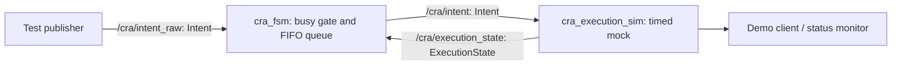

# Collaborative Robot Assistant (CRA)

CRA is an ongoing robotics project aiming to translate English/Korean voice commands into coordinated mobile-robot and arm behaviors. **The current runnable milestone is a ROS 2 command coordinator with a timed mock executor. It does not move a robot.**

## Current architecture



The FSM sends one command at a time and queues additional requests. A DONE or ERROR transition releases the next command. The mock executor reports progress over approximately two seconds and stays in DONE until another command arrives. No intent-specific behavior or validation is implemented yet.

## Environment and build

Recovered and checked on Ubuntu 22.04 under WSL 2, ROS 2 Humble, Python 3.10. Requires ROS 2, colcon, rclpy, rosidl message generation, launch, and launch_ros.

From the workspace root (the directory containing src):

```bash
source /opt/ros/humble/setup.bash
colcon build
```

## Run the demo

Terminal 1, from the workspace root:

```bash
bash scripts/run_demo.sh
```

Terminal 2, from the same workspace:

```bash
bash scripts/send_demo.sh
```

The client sends three mock commands in a burst, shows state transitions, and checks that all three are dispatched and completed in order. Expect PASS after roughly six seconds. Run with a fresh launch and no other command publishers. Stop the nodes with Ctrl+C after the demo.

Both terminals must use the same ROS_DOMAIN_ID if you set one. For isolated local testing, set `export ROS_DOMAIN_ID=187 ROS_LOCALHOST_ONLY=1` in both terminals before running the scripts.

To inspect continuous feedback in another sourced terminal:

```bash
source /opt/ros/humble/setup.bash
source install/setup.bash
ros2 topic echo /cra/execution_state
```

## Packages and interfaces

| Package | Responsibility |
|---|---|
| cra_msgs | Intent and ExecutionState message definitions |
| cra_fsm | Command gating, FIFO queue, execution feedback |
| cra_execution_sim | Timed mock execution and status publishing |

Intent contains `intent_type` and `args`. ExecutionState contains `state`, `intent_type`, `args`, `progress`, and `detail`.

`/cra/intent_raw` and `/cra/intent` separate requests from dispatched commands by convention. This is not an enforced security boundary; other publishers can still bypass the FSM.

## Limitations

- No ASR, NLU, Gazebo robot, Nav2, perception, or MoveIt integration in this workspace yet.
- All intent names are accepted and simulated identically.
- No command IDs, timeout, cancellation, queue limit, or restart recovery.
- Feedback is matched by state transitions, not command identity; stale feedback handling needs hardening.
- The executor accepts direct commands even while busy; normal serialization depends on using the FSM.
- Automated demo verifies normal completion, not the ERROR/recovery path.

## Roadmap

1. Validate intents and define deliberate failure behavior.
2. Connect one narrowly scoped robot behavior in Gazebo.
3. Add navigation, perception, manipulation, and bilingual voice incrementally.

See PROJECT_STATUS.md for the recovery checkpoint and verification record.
