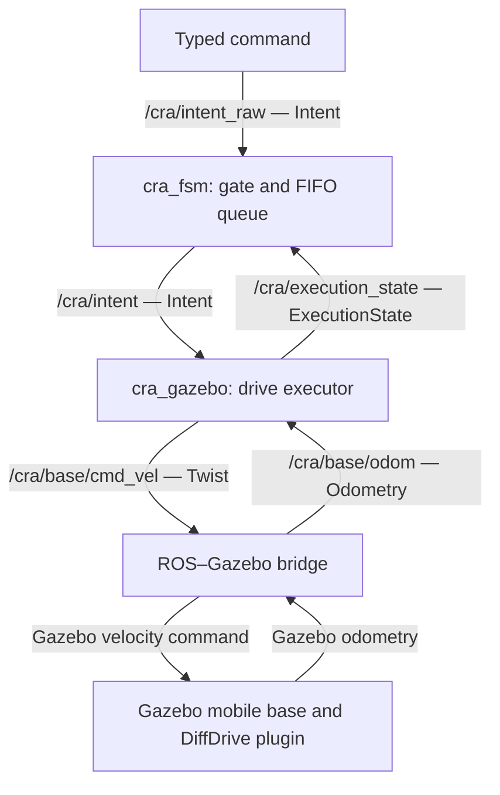

# Collaborative Robot Assistant (CRA)

CRA is an ongoing ROS 2 robotics project exploring how user commands can become coordinated robot behaviors.

The current milestone is a Gazebo mobile-base demonstration: a typed forward-motion request passes through a queued task coordinator, drives a simulated robot, and reports progress and completion using odometry.

The longer-term goal is an English/Korean voice-controlled mobile robot with navigation, perception, and manipulation.

## Current capabilities

- Execute move_forward requests for distances between 0.1 and 2.0 metres.

- Queue incoming requests and execute them one at a time.

- Adjust forward speed based on remaining distance.

- Stop near the target and publish structured execution feedback.

- Reject invalid distances and continue processing subsequent requests.

- Detect stale odometry and enforce a motion timeout.

## Architecture



The FSM decides when a request may execute. The drive executor validates the request and controls forward movement. Gazebo simulates the robot, and the bridge translates messages between ROS and Gazebo.

Validation currently occurs in the drive executor. The raw/dispatched topic separation is an architectural convention, not an enforced security boundary.

## Environment

Verified on:

- Ubuntu 22.04 through WSL 2.

- ROS 2 Humble.

- Gazebo Fortress with ros_gz.

- Python 3.10.

The launch file uses Ogre rendering because the default Ogre 2 renderer failed in the tested WSL graphics environment.

## Build

These instructions assume ROS 2 Humble and colcon are already installed.

Install the simulation dependencies:

```bash
sudo apt-get update
sudo apt-get install ros-humble-ros-gz ignition-fortress
```

From the workspace root—the directory containing src/:

```bash
source /opt/ros/humble/setup.bash
colcon build
```

## Run the Gazebo demo

Run only one CRA demo at a time. The Gazebo and mock executors share command and feedback topics.

Terminal 1, from the workspace root:

```bash
bash scripts/run_gazebo.sh
```

Terminal 2, from the workspace root:

```bash
bash scripts/move_forward.sh
```

The second command requests a 0.5-metre forward move. Watch the robot move and the launch terminal report DONE.

To observe structured feedback in another terminal:

```bash
source /opt/ros/humble/setup.bash
source install/setup.bash
ros2 topic echo /cra/execution_state
```

To send a custom distance:

```bash
ros2 topic pub --once /cra/intent_raw cra_msgs/msg/Intent \
  "{intent_type: move_forward, args: ['1.0']}"
```

The custom command requires the sourced environment shown above.

Press Ctrl+C in the launch terminal to stop the system. Stop any topic-monitoring commands separately.

See [GAZEBO_DEMO.md](GAZEBO_DEMO.md) for further instructions and limitations.

## Packages

|Package|Responsibility|
|---|---|
|`cra_msgs`|Defines `Intent` and `ExecutionState` messages|
|`cra_fsm`|Queues requests, dispatches commands, and processes completion feedback|
|`cra_execution_sim`|Provides the original timed mock executor|
|`cra_gazebo`|Provides the robot world, bridge launch, and distance-based drive executor|

## Verification

Automated checks covered:

- Building all four packages and validating the world description.

- Rejecting an invalid NaN distance.

- Completing queued 0.5 m and 0.3 m moves in order.

- Checking odometry displacement and stopping drift.

One integration run measured approximately 0.486 m and 0.285 m for those moves, with 0.0012 m of additional displacement during the following second. Completion uses a 0.015 m distance tolerance.

Manual inspection confirmed visible movement and stopping, velocity and odometry feedback, queueing, and recovery after a rejected negative-distance request.

These measurements use odometry, not an independent ground-truth position check. See [PROJECT_STATUS.md](PROJECT_STATUS.md) for the verification record.

## Original mock demo

The original executor simulates each task for approximately two seconds without moving a robot.

With the Gazebo demo stopped, run in separate terminals:

```bash
bash scripts/run_demo.sh
```

```bash
bash scripts/send_demo.sh
```

The client checks that three mock commands dispatch and complete in order.

## Limitations and future work

- Forward motion only; no heading correction, route planning, or obstacle avoidance.

- No voice input, language parsing, Nav2, perception, or arm manipulation yet.

- No command IDs, cancellation, queue limit, or restart recovery.

- The FSM detects state transitions rather than matching feedback to unique commands.

- The current error policy advances to the next queued request.

- The mock executor can replace an active task if commanded directly; the Gazebo executor ignores direct commands while busy.

- This is a simulation demonstration, not a hardware-ready control system.

Future work includes stronger task coordination, additional robot skills, and incremental integration of navigation, perception, manipulation, and bilingual voice input.
